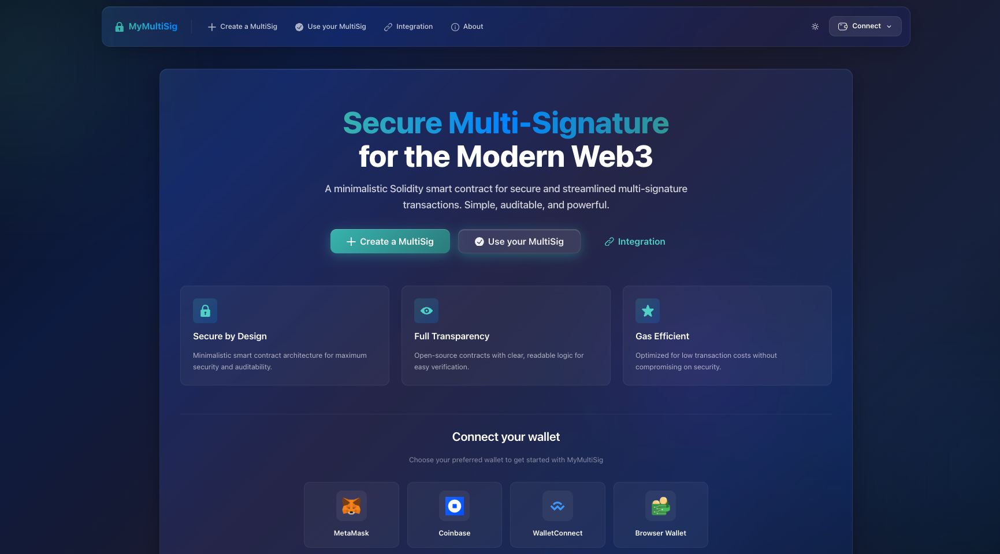

# MyMultiSig.app — Next.js Web App

Build, sign, and execute multi-signature transactions across popular EVM networks with a minimal, fast UI.

<p align="center">
  
</p>

[](LICENSE)
[](https://app.netlify.com/sites/mymultisig/deploys)
[](https://github.com/marc-aurele-besner/mymultisig-app/actions/workflows/next-build.yml)
[](https://github.com/marc-aurele-besner/mymultisig-app/actions/workflows/storybook-build.yml)

## Live

- App: [MyMultiSig.app](https://MyMultiSig.app/)
- Storybook: [storybook.mymultisig.app](https://storybook.mymultisig.app)

## 1‑Click Deploy (Netlify)

[](https://app.netlify.com/start/deploy?repository=https://github.com/marc-aurele-besner/mymultisig-app)

## Features

- Create a new multi-signature wallet (owners and threshold)
- Import an existing multi-signature by address
- Build requests to:
  - Call any contract function (ABI-driven)
  - Send regular ETH transfers
- Share request links for review/signing
- Execute transactions once threshold is met
- Wallets: MetaMask, WalletConnect v2, Coinbase Wallet, Injected, Ledger
- Progressive Web App (PWA) with offline support
- Optional analytics via Google Analytics
- AI agents and automation: MCP server, Claude Code skills, scoped API keys, CLI and TypeScript SDK ([below](#ai-agents--automation))

## AI agents & automation

Agents and scripts can create wallets, read the queue, propose requests, sign them and execute them. Every flow uses the same scoped API keys, which you create at [Settings → API keys](https://mymultisig.app/settings/api-keys). On-chain approvals are always signed **locally** with the agent's own owner key (`MYMULTISIG_PRIVATE_KEY`); keys never reach the server.

| Flow | Get started | Package |
|---|---|---|
| **MCP server**: tools for Claude, Cursor or any MCP client | `claude mcp add mymultisig -e MYMULTISIG_API_KEY=mms_… -- npx -y mymultisig-mcp` | [`mymultisig-mcp`](https://www.npmjs.com/package/mymultisig-mcp) |
| **Claude Code skills**: status, create, propose, review-and-sign and execute workflows, with the MCP server included | `/plugin marketplace add marc-aurele-besner/mymultisig-app` then `/plugin install mymultisig@mymultisig` | [`plugins/mymultisig`](plugins/mymultisig) |
| **REST API**: Bearer keys with `read`, `propose`, `sign` and `manage` scopes, optionally per wallet | `curl -H "Authorization: Bearer mms_…" https://mymultisig.app/api/agent-keys/whoami` | [OpenAPI 3.1](https://mymultisig.app/openapi.json), [llms.txt](https://mymultisig.app/llms.txt) |
| **CLI**: human-readable or `--json` output | `npx mymultisig-cli --help` | [`mymultisig-cli`](https://www.npmjs.com/package/mymultisig-cli) |
| **TypeScript SDK**: the same protocol code this app runs | `npm i mymultisig-sdk viem` | [`mymultisig-sdk`](https://www.npmjs.com/package/mymultisig-sdk) |

The safest setup is a threshold the agent can't reach alone. For example, in a 2-of-3 with two humans plus the agent, the agent can prepare and co-sign, but nothing moves without a human signature. The user guide is at [mymultisig.app/docs/ai-agents](https://mymultisig.app/docs/ai-agents), and the operator notes (scopes, storage, publishing) are in [`docs/ai-agents.md`](docs/ai-agents.md).

## Supported Networks

- Ethereum: Mainnet, Sepolia, Goerli
- Polygon: Mainnet, Mumbai
- Optimism: Mainnet, Goerli
- Arbitrum: One, Goerli
- Avalanche: C-Chain, Fuji
- BNB Chain: Mainnet, Testnet
- Gnosis: Mainnet, Chiado

(Driven by `src/constants/networks.ts` and factory addresses from `mymultisig-contract`.)

## Tech Stack

- Next.js 13, React 18, TypeScript
- Chakra UI
- wagmi + WalletConnect
- Zustand
- next-pwa
- Storybook

## Quick Start

### Prerequisites

- Node.js 16+ (CI uses Node 16)
- Yarn 1.x
- Netlify CLI (optional, for `yarn netlify dev`): `npm i -g netlify-cli`

### Setup

```bash
yarn
cp .env.example .env.local
# Fill in the values in .env.local
```

### Run

- Next.js dev server:

```bash
yarn dev
```

- Netlify dev (proxies serverless functions locally):

```bash
yarn netlify dev
```

### Build

```bash
yarn build
```

### Storybook

```bash
yarn storybook
# or build static storybook
yarn build-storybook
```

## Environment Variables

Create `.env.local` (see `.env.example` for a full list and guidance).

Public (client) variables:

- `NEXT_PUBLIC_WALLET_CONNECT_PROJECT_ID` — WalletConnect v2 Project ID (recommended)
- `NEXT_PUBLIC_ALCHEMY_API_KEY` — optional, improves RPC performance
- `NEXT_PUBLIC_INFURA_API_KEY` — optional, improves RPC performance
- `NEXT_PUBLIC_APP_GTAG` — optional, Google Analytics ID

Server-only variables:

- `ETHERSCAN_API_KEY` — required for ABI fetch in `/api/getABI`
- `DATABASE_URL` — Neon PostgreSQL connection string (required for storing/retrieving requests)
- `PRIVATE_KEY` — backend signer used to sign messages; do NOT use a key with funds
- `SLACK_TOKEN` and `SLACK_CONVERSATION_ID` — optional notifications

Auth (optional; used by `/api/auth/[...nextauth]`):

- `GITHUB_ID`, `GITHUB_SECRET`
- `GOOGLE_ID`, `GOOGLE_SECRET`
- `DISCORD_ID`, `DISCORD_SECRET`
- `TWITTER_ID`, `TWITTER_SECRET`
- `SLACK_ID`, `SLACK_SECRET`

## Common Tasks

- Create a wallet: `Create` page → choose name, owners, and threshold → confirm in wallet
- Import a wallet: `Import` page → paste wallet address → confirm
- Build a request: open a wallet → “Build a request” → select contract/function or regular tx → enter args → “Sign request”
- Share/Sign: share the request link (`/request/[requestId]`) with owners to collect signatures
- Execute: once threshold is met, execute from the request page or the wallet view

## Project Structure

- `src/pages` — Next.js routes (including API routes under `pages/api`)
- `src/components` — UI components and views
- `src/constants` — networks, providers, factory addresses
- `src/hooks` — wagmi hooks and domain hooks
- `src/models` — TypeScript models
- `src/states` — Zustand stores (persisted in LocalStorage)
- `public` — PWA manifest and icons, `llms.txt`, `openapi.json`
- `packages/sdk`, `packages/mcp`, `packages/cli` — npm packages for agents (`mymultisig-sdk`, `mymultisig-mcp`, `mymultisig-cli`); the app imports the SDK's protocol core
- `plugins/mymultisig` — Claude Code plugin (skills + MCP config)

## Scripts

- `yarn dev` — start Next.js dev server
- `yarn netlify dev` — start with Netlify dev
- `yarn build` — production build
- `yarn analyze` — bundle analyzer
- `yarn storybook` / `yarn build-storybook`
- `yarn packages:build` / `yarn packages:test` — build and test the agent packages

## CI

- Next build check (including the agent package build and tests) and Storybook build run on PRs via GitHub Actions.

## Security & Disclaimer

This project is under active development. Use at your own risk. Always test with small amounts and/or on test networks first.

## License

MIT © MyMultiSig.app

## Acknowledgements

- Built with [Next.js](https://nextjs.org/) and [Chakra UI](https://chakra-ui.com/)
- Contract ABIs and factory addresses from `mymultisig-contract`
- Stories documented in [Storybook](https://storybook.js.org/)
